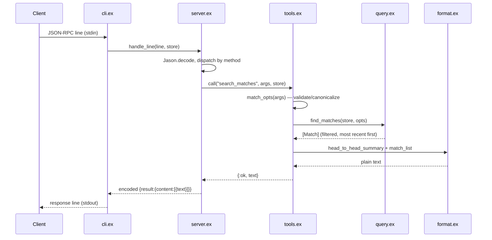

# Flow

A client sends one JSON-RPC line per request. `cli.ex:serve/3` reads it, `server.ex:handle_line/2` decodes and dispatches by method. For `tools/call`, `tools.ex` validates and canonicalizes arguments (competition names, seasons, dates, venue) returning a readable `{:error, msg}` on bad input rather than crashing, then runs a pure `query.ex` function over the pre-loaded in-memory `Store`. `format.ex` renders the result as spec-formatted plain text, and `server.ex` wraps it in an MCP `content` block. All data is loaded once at start-up in `cli.ex:main/1`; queries touch no I/O.

Notable: clean separation of protocol / tools / pure query / formatting; argument errors are surfaced as tool `isError` results, not exceptions; no network access (optional APIs in the spec were correctly skipped in favor of the provided CSVs); start-up ~2.5s, queries in milliseconds.
