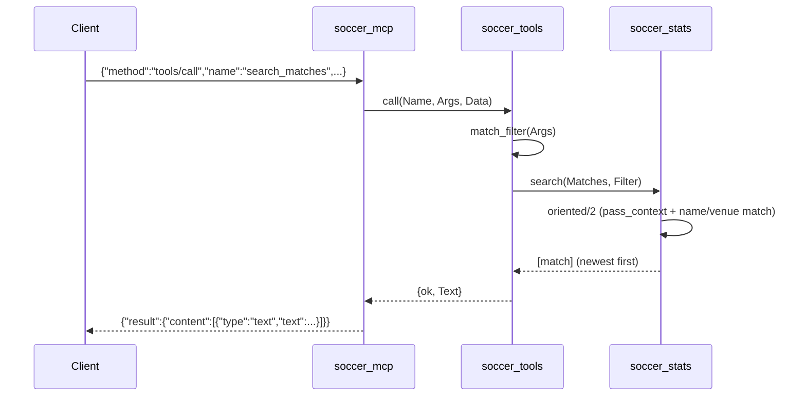

# Flow

At startup `soccer_mcp:main/1` loads all six CSVs via `soccer_loader:load/1` (parsing, team-name canonicalization, dedupe, cup-final marking) into an in-memory `#{matches, players}` map, logging counts to stderr so stdout stays clean for the protocol. The server then loops reading one JSON line at a time. A `tools/call` for `search_matches` builds a filter map from the arguments, calls `soccer_stats:search/2`, which filters matches by context (season/competition/stage/date) and by team/opponent via accent-folded token subset matching, orients each match to the queried team's side, sorts newest-first, and returns normalized match maps. `soccer_tools` formats them as plain text and wraps them in an MCP text content result. Bad arguments are caught in `soccer_tools:call/3` and returned as MCP tool errors (`isError: true`) rather than crashing the loop.
