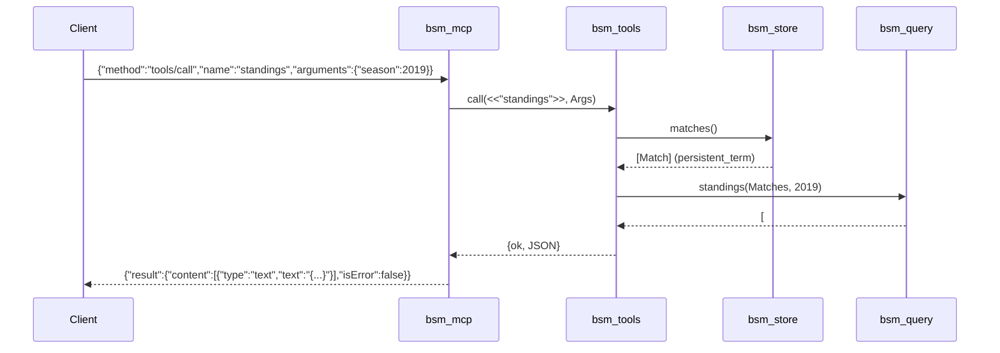

# Flow

A `tools/call` line is read by `bsm_mcp:run/0`, trimmed, JSON-decoded, and dispatched. For `standings`, `bsm_tools` reads the matches snapshot from `bsm_store` (loaded once into `persistent_term` at startup), delegates to the pure `bsm_query:standings/2` which folds match results into a points table (3/1/0, tie-broken by wins, goal difference, goals scored, name), encodes the table as JSON text, and wraps it in an MCP `content` result. All data is loaded eagerly at boot and queried in-process; there is no database or network I/O on the request path. Tool-level errors (bad/missing arguments) are returned as `isError:true` text content rather than JSON-RPC protocol errors, which are reserved for unknown tools/methods and malformed JSON.
