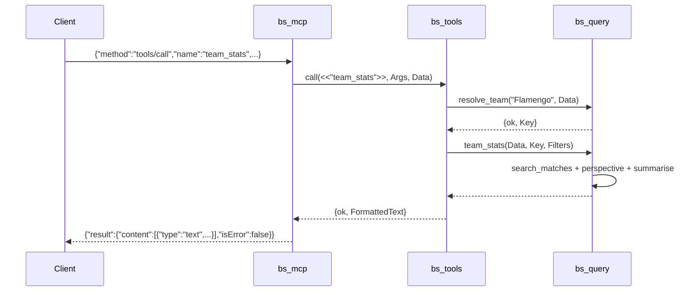

# Flow

At startup `brazilian_soccer_mcp:main/1` calls `bs_data:load/1` once, which parses the six CSVs (`bs_csv:read_maps`), dedupes matches across files, normalises team names into keys (base name, state-qualified only where ambiguous), and returns one in-memory dataset. `bs_mcp:run/1` then reads JSON-RPC lines from stdin in a loop. A `tools/call` is dispatched through `bs_tools:call/3`, which parses/validates arguments, resolves free-text team names to keys via `bs_query:resolve_team/2`, runs the pure query function in `bs_query`, and formats the result as human-readable text. The dataset is immutable and shared read-only across every request.

Notable, factual points: queries are pure functions over an immutable map and scan the full match list per call (linear scan, no indexes); argument validation returns descriptive `{error, Text}` that is surfaced as an `isError` tool result rather than a protocol error; team-name resolution falls back to unique-substring matching and reports ambiguity; the dedupe step treats matches within one day as equal to reconcile differently-dated copies across files.
