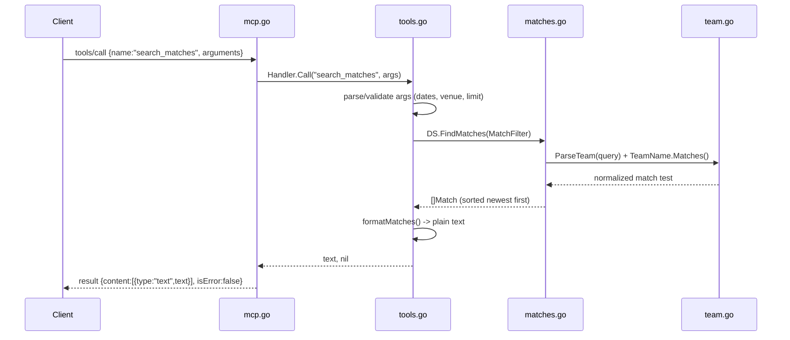

# Flow

At startup `main.go` calls `LoadDataset` once, reading the five match CSVs in priority order (later files only add competition/season pairs not already covered, with a fixture-key de-dup safety net) plus `fifa_data.csv`, and holds everything in memory. The MCP loop in `mcp.go:Serve` scans newline-delimited JSON-RPC from stdin; `handleLine` drops notifications (nil id) and `dispatch` routes by method. A `tools/call` for `search_matches` flows to `Handler.Call`, which validates arguments, builds a `MatchFilter`, and calls `FindMatches`. Matching relies on `team.go`'s normalization: names are stripped of accents, noise words and state suffixes to a token set, and a query matches when its tokens are a subset of the candidate's and any state codes agree. Results are sorted newest-first and rendered as plain text mimicking the spec's example answers, returned as an MCP text content result.

Notable deviations from common patterns: no HTTP layer (stdio MCP only); all data held in memory with linear scans per query (no index, no pagination beyond a `limit` cap); tool errors are returned as `isError` text results rather than JSON-RPC protocol errors; required-argument validation happens inside each handler, not via schema enforcement; standings/record maths are recomputed from matches on every call.
