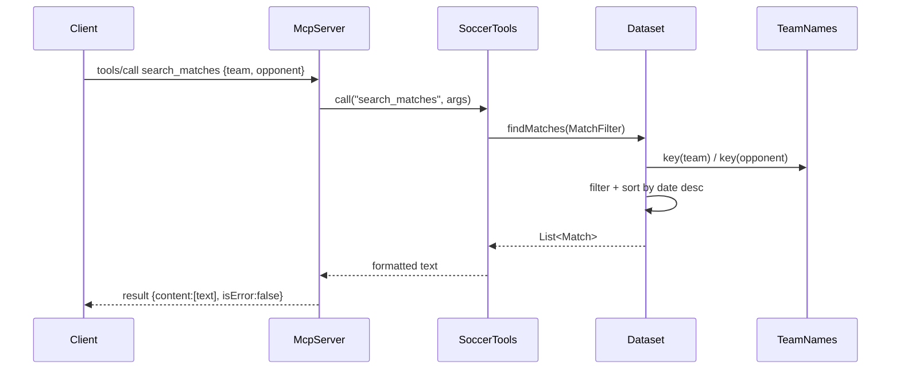

# Flow

A client sends a `tools/call` JSON-RPC message naming a tool (e.g. `search_matches`) with arguments. `McpServer.handle` dispatches on the method, `callTool` validates the tool name, and `SoccerTools.call` runs the matching handler. The handler builds a `MatchFilter`, which `Dataset.findMatches` evaluates by normalizing team names through `TeamNames.key`, filtering the in-memory match list, and sorting most-recent-first. The result is rendered as plain text and wrapped in an MCP `content` result. Invalid arguments raise `IllegalArgumentException`, which is returned as a tool-level error (`isError:true`) rather than a protocol error, so a connected model can read and correct it. Data is loaded once at startup (`DataLoader.load`) and held read-only; there is no network access or database.
