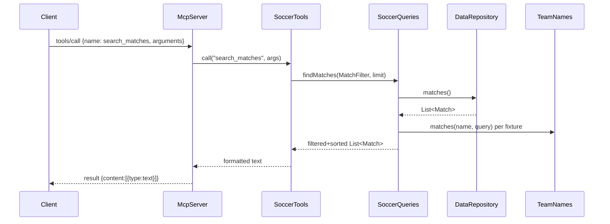

# Flow

At startup `Main` calls `DataRepository.load()`, which reads all six CSVs via `DataLoader`, converts rows to `Match`/`Player` records, and de-duplicates overlapping fixtures (same team keys + score within 3 days) before building an immutable in-memory store. A `tools/call` request is parsed by `McpServer`, dispatched by `SoccerTools` to the matching `SoccerQueries` method, which streams over the in-memory lists applying filters (team/opponent via `TeamNames.matches`, competition/season/date/venue), sorts newest-first, caps at `limit`, and returns text formatted for an LLM. Errors throw `IllegalArgumentException`, surfaced as a JSON-RPC error or an `isError` tool result. Notable: queries are linear scans over in-memory lists (no indexes), and all data is loaded eagerly at process start.
