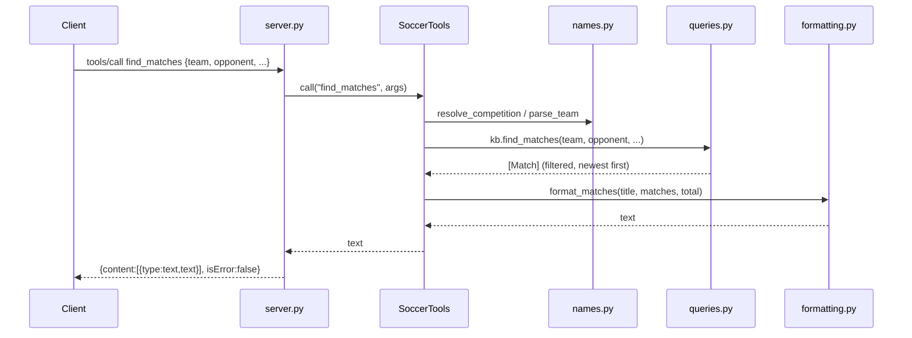

# Flow

A JSON-RPC `tools/call` line is read from stdin and parsed in `serve()`. `handle_message`
dispatches `tools/call` to `SoccerTools.call`, which looks the tool up in its registry and
runs the bound handler. The handler normalizes free-text team/competition names
(`names.py`), queries the in-memory `SoccerKnowledgeBase` (loaded once at startup from the
six CSVs), formats the result as text, and the server writes a JSON-RPC response line back
to stdout. Errors from a handler (`KeyError`/`ValueError`/`TypeError`) are returned as
`isError:true` tool results rather than JSON-RPC errors; unknown methods return `-32601`.

Notable: the MCP layer is implemented directly on JSON-RPC rather than via the official
`mcp` Python SDK (no third-party dependencies — standard library only). All data is loaded
eagerly into memory at startup; overlapping source files are de-duplicated per
(competition, season) by source priority. No persistence, no network calls, no auth.
