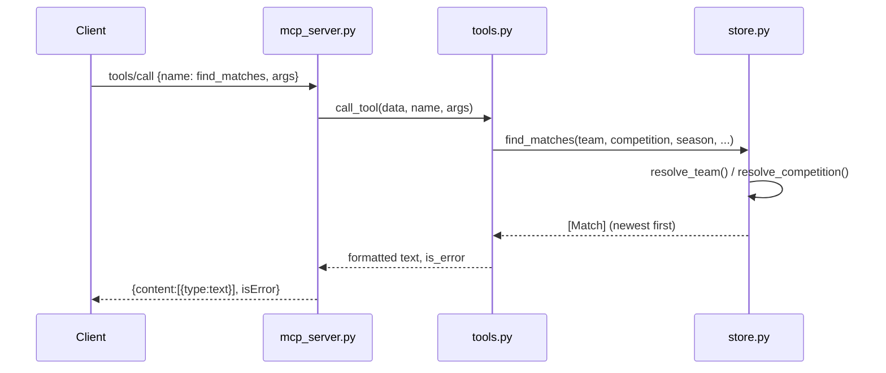

# Flow

A `tools/call` request is parsed line-by-line in `MCPServer.serve`, dispatched to `call_tool`, which looks the tool up by name and runs its handler. The handler resolves fuzzy team/competition input to canonical keys via `SoccerData`, filters the pre-indexed, de-duplicated match list, and returns a plain-text answer shaped like the TASK.md examples. `QueryError` and bad arguments are caught and returned as `isError: true` text rather than raising a protocol error. Data is loaded once at startup (`SoccerData.load`), de-duplicated across overlapping Brasileirão sources, and indexed by team key.
