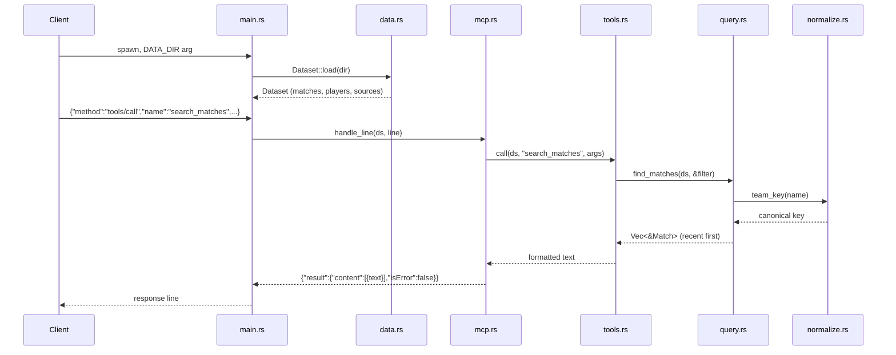

# Flow

At startup `main.rs` loads all six CSVs once into an in-memory `Dataset`; match sources
are deduped (same competition + unordered team pair within one day). Each stdin line is a
JSON-RPC message: `mcp.rs:handle_line` dispatches by method, routing `tools/call` to
`tools.rs:call`, which parses/validates arguments and delegates to the pure `query.rs`
functions. Team names are normalized through `normalize.rs:team_key` so variant spellings
(e.g. `Palmeiras-SP`, `Sociedade Esportiva Palmeiras`) collapse to one key. Results are
formatted as human-readable text and returned as an MCP tool result. Argument errors
return `isError:true` rather than a protocol error, so the model can self-correct. Logs go
to stderr to keep the stdout protocol stream clean.
