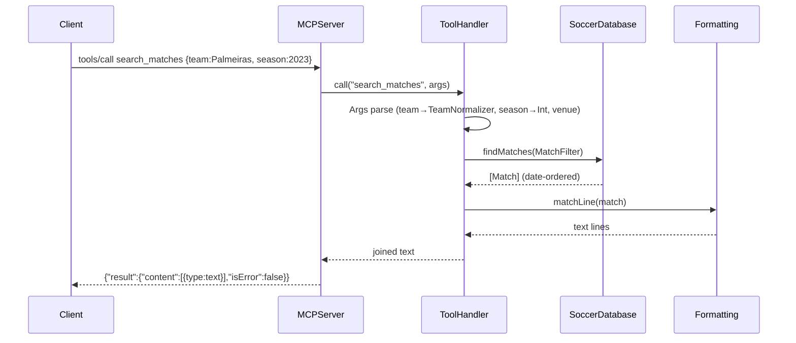

# Flow

A `tools/call` line is parsed by `MCPServer.handle` into method + params, then dispatched to `ToolHandler.call`, which matches the tool name in a switch. `Args` coerces JSON argument values (strings/numbers) and normalizes team names via `TeamNormalizer`. The query runs as a pure read over the in-memory `SoccerDatabase` (`findMatches` applies the `MatchFilter`), results are rendered to plain text by `Formatting`, and wrapped in an MCP `content` text block. The `ask` tool adds one hop: `QueryRouter.route` turns a natural-language question into a `(tool, arguments)` pair, then re-enters `call`.

Notable: server is synchronous, line-at-a-time stdio; all data is loaded into memory once at startup (no DB engine); no external dependencies (pure Foundation). Malformed JSON returns a JSON-RPC -32700 parse error with a null id; notifications (no `id`) get no response.
