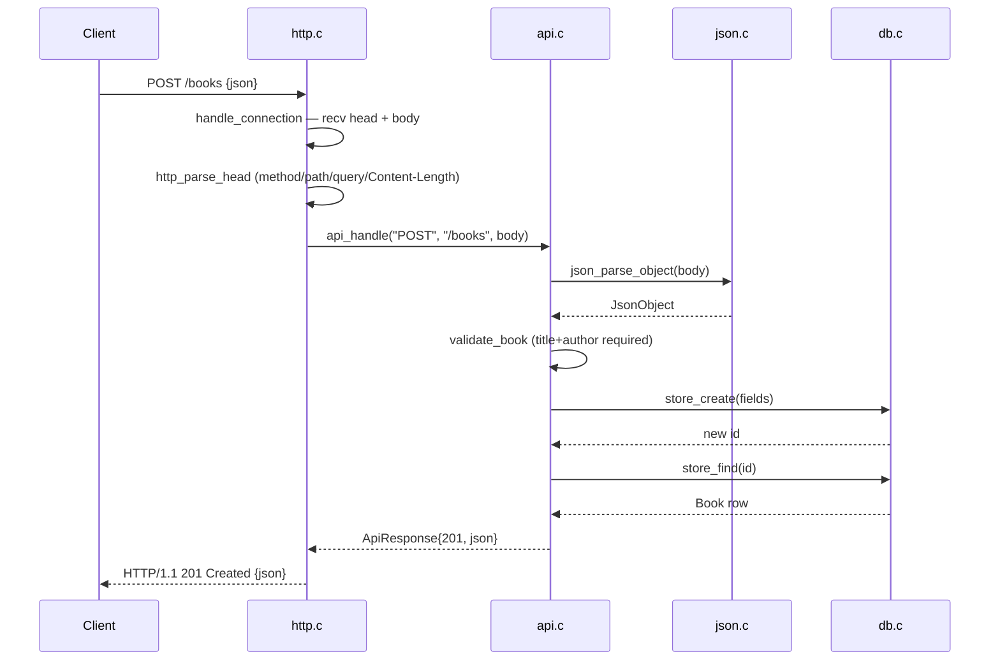

# Flow

A request to `POST /books` is read off the socket by `handle_connection`, which
accumulates the header block up to `\r\n\r\n`, parses the request line and
`Content-Length` with `http_parse_head`, then reads exactly that many body
bytes. `api_handle` dispatches on method+path to `create_book`, which parses the
JSON body, validates that `title` and `author` are present non-blank strings
(and that optional `year`/`isbn` are well-formed), inserts via a prepared
statement, re-reads the inserted row, and serializes it back as JSON with a
`201`. The connection is single-request (`Connection: close`) and the server
loops one connection at a time (`http_serve`), with a bounded-iteration mode
used by the test harness.

Notable, factual observations (not judgments):

- Input validation is thorough: blank-string rejection, length caps (1000
  chars), year range `0..9999` with integer/NaN guards, ISBN-10/13 shape check
  (checksums not verified).
- `PUT` is a full replace — omitted optional fields are reset to null.
- The JSON parser is strict (rejects trailing data, control chars, lone
  surrogates, `\u0000`, leading-zero numbers) and decodes `\uXXXX` incl.
  surrogate pairs to UTF-8.
- Server is synchronous and serves one connection per accept (no concurrency);
  bound to `127.0.0.1` only. HTTP keep-alive and chunked transfer are not
  supported (chunked is explicitly rejected).
- Body size capped at 1 MiB, header block at 16 KiB, with a 5s recv timeout.
