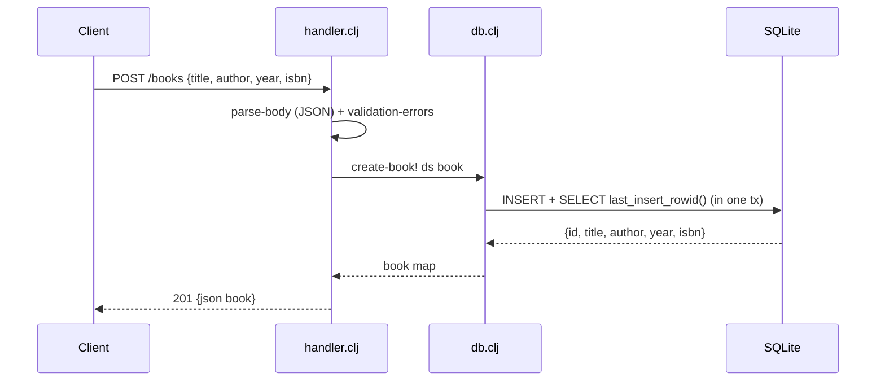

# Flow

A `POST /books` request is routed by `handler.clj:handle`. The body is slurped and parsed as a JSON object (`parse-body`); a non-object body returns `400`. The four book fields are selected and checked by `validation-errors` — a blank `title` or `author`, or a non-integer `year`, yields `422` with a `details` list. On success, `db/create-book!` inserts the row and reads it back via `last_insert_rowid()` inside a single transaction (correct, since the rowid is per-connection), returning the persisted book with its generated id as `201`. Requests are wrapped by `wrap-params` (for `?author=`) and a top-level try/catch that maps unexpected errors to `500`. Validation failures use `422` rather than `400`; this is documented in the README and is a reasonable HTTP choice.
