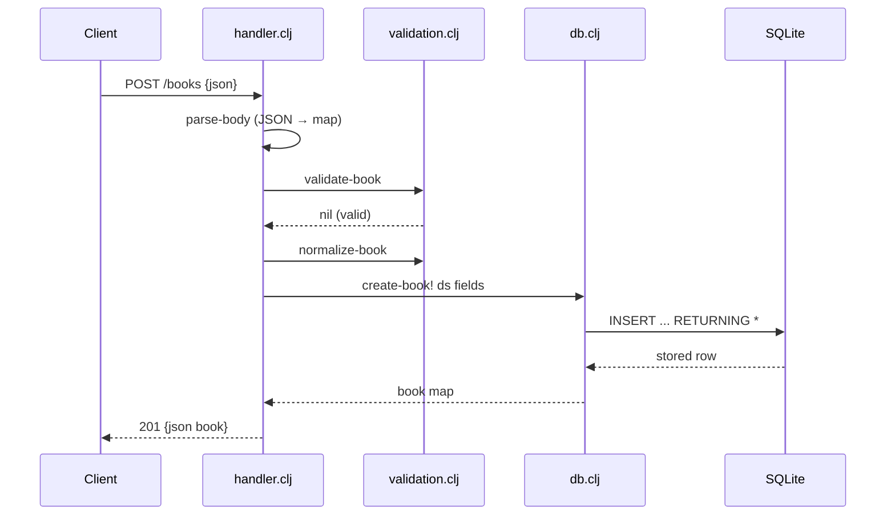

# Flow

A `POST /books` request is routed by `make-handler*`, its body slurped and parsed to a keyword-keyed map by `parse-body` (a non-object or malformed body yields `400`). `validate-book` enforces that `title` and `author` are non-blank strings and that `year`/`isbn`, when present, have the right types; failures return `422` with a per-field `fields` map. On success the fields are trimmed by `normalize-book` and inserted via next.jdbc's `INSERT ... RETURNING *`, and the stored row is returned as JSON with `201`. Routing is hand-rolled over path segments; `wrap-params` supplies the `?author=` query filter for `GET /books`. Error handling is centralized in a top-level `try/catch` that logs to stderr and returns `500`.
