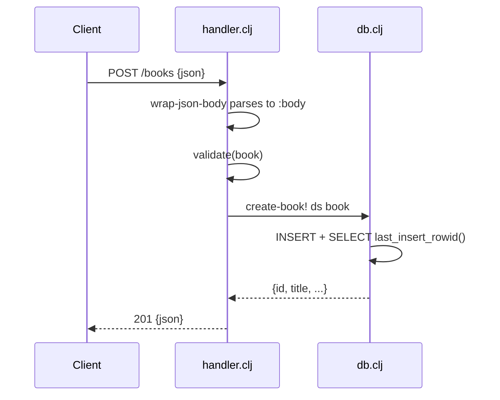

# Flow

A `POST /books` request is JSON-decoded by `wrap-json-body` into `:body`, trimmed to the four book fields by `book-body`, then checked by `validate` (title and author required and non-blank; year must be an integer if present; isbn a string if present). On success `db/create-book!` inserts inside a transaction and re-selects the row by `last_insert_rowid()`, which `wrap-json-response` serializes as `201`. Validation failures short-circuit to `400` with a `:details` error map before touching the DB. Error handling is present for validation, missing resources (404), malformed JSON (400), and non-numeric ids; there is no pagination and the author filter is an exact match only.
