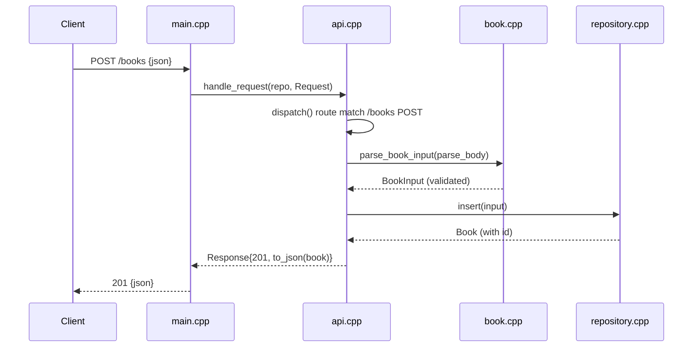

# Flow

A POST to `/books` is read by the blocking Beast server in `main.cpp`, which builds a `Request` and calls the socket-free `handle_request`. `dispatch` strips the query string, matches the path, and for POST `/books` parses and validates the body in `book.cpp` (title/author required and trimmed, year 1–9999, ISBN-10/13 shape, hyphens stripped), then persists via `repository.cpp` using a prepared SQLite statement. Validation failures surface as `ValidationError` → 400 and unique-isbn collisions as `DuplicateIsbnError` → 409, both caught centrally in `handle_request`. Clean separation of validation, storage, and routing from the socket layer makes the core unit-testable without a live server.
