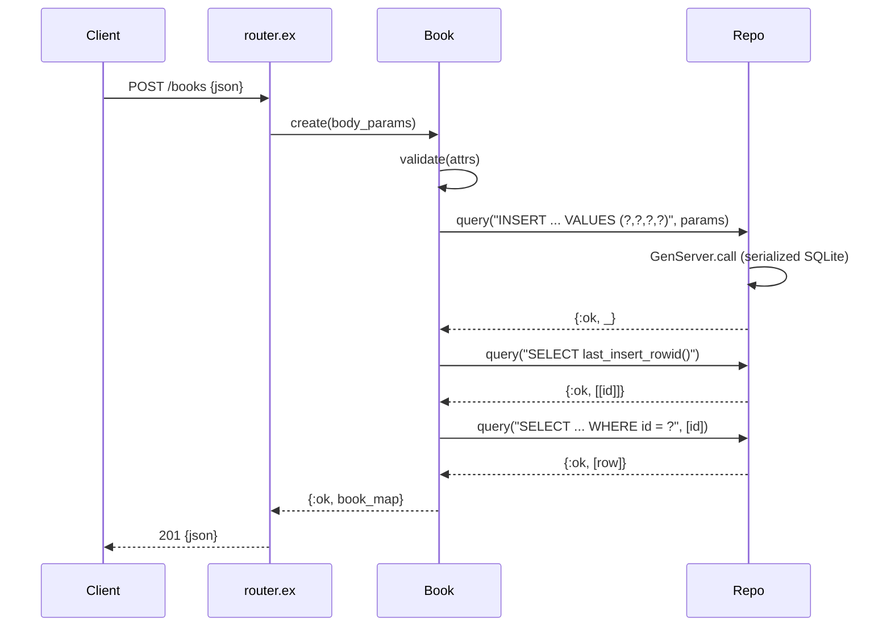

# Flow

A `POST /books` request is JSON-parsed by `Plug.Parsers`, then `Book.create/1`
validates (title/author required non-blank, year optional 0–9999 integer, isbn
optional string). On success it inserts via the single `Repo` GenServer that
serializes all SQLite access, reads back the row by `last_insert_rowid()`, and
returns `201` with the created book. Validation failures short-circuit to `422`
with a `details` map. All DB access is serialized through one GenServer-owned
connection — simple and race-free, but a single-writer bottleneck under load.
