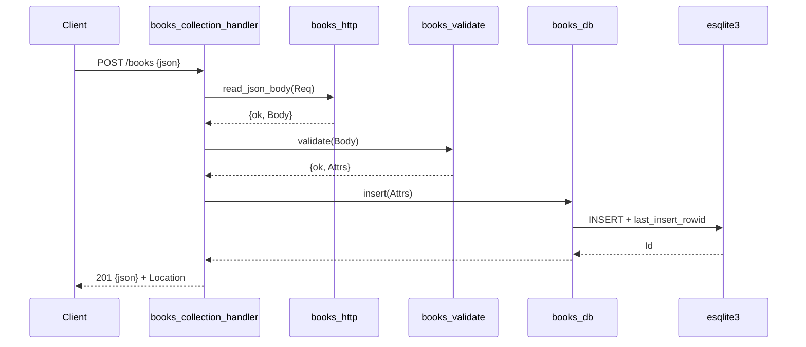

# Flow

A `POST /books` reads and JSON-decodes the body, validates it (title/author required, year/isbn optional and null-defaulted), and on success calls the `books_db` gen_server, which serialises the `INSERT` against the single SQLite connection and returns the persisted row. The handler replies `201` with the book JSON and a `Location: /books/{id}` header. Validation failures short-circuit to `400` with a `details` list; malformed JSON returns `400` before validation. All DB access is funnelled through one gen_server process, so writes are serialised; esqlite3 errors are turned into process crashes so the supervisor restarts the DB owner rather than returning corrupt state.
