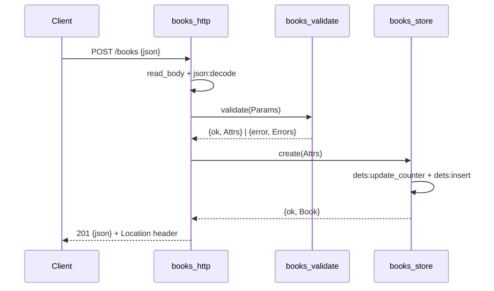

# Flow

A `POST /books` reads the full request body, decodes it with the OTP 27 built-in
`json` module (a decode failure short-circuits to `400`), then validates it via
`books_validate:validate/1` (title and author required; year/isbn checked when
present, with every error collected rather than failing on the first). On success
the normalised attributes are handed to the `books_store` gen_server, which
allocates a sequential id through a persisted DETS counter and inserts the book,
returning `201` with a `Location` header. Persistence is DETS (a disk-backed OTP
table), so data and the id counter survive a restart — exercised by the
`books_survive_restart` store test. All store access is serialised through one
gen_server, giving simple concurrency safety.
