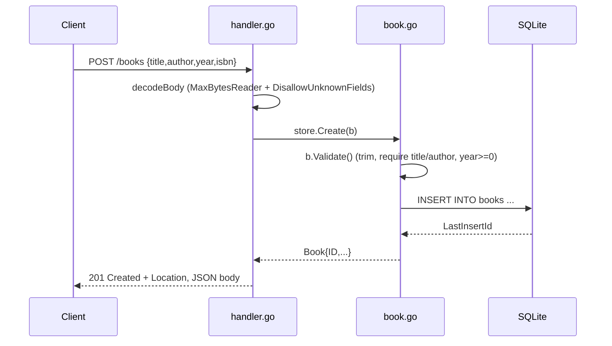

# Flow

A `POST /books` request is decoded with strict JSON options (1 MiB cap, unknown fields rejected), then passed to `store.Create`, which calls `Book.Validate` (trims whitespace, requires non-empty title and author, rejects negative year) before inserting into the SQLite `books` table and returning the row with its assigned ID. The handler maps store errors by type: `ValidationError` → `400` with a per-field map, `ErrNotFound` → `404`, anything else → `500`. The author filter on `GET /books` uses `WHERE author = ? COLLATE NOCASE` for case-insensitive exact matching. No pagination; `SetMaxOpenConns(1)` serializes writes.
