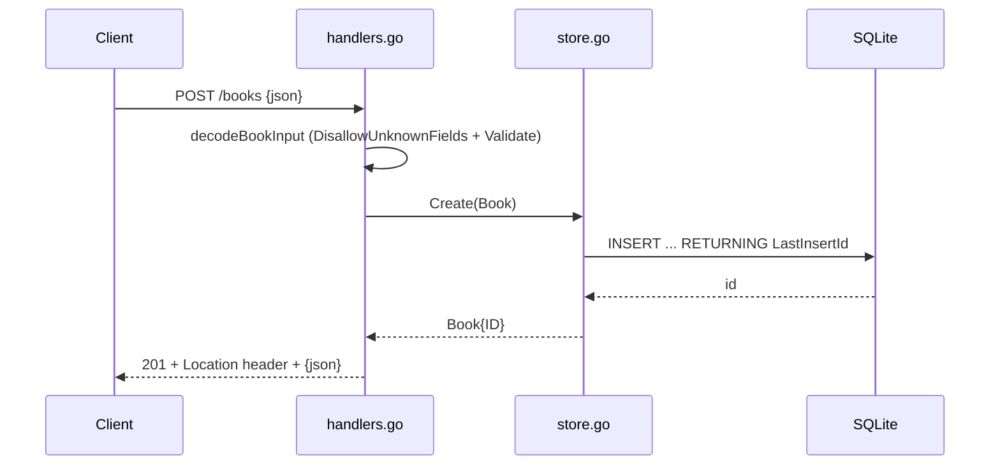

# Flow

A `POST /books` request is capped at 1 MiB and decoded with `DisallowUnknownFields`; `bookInput.Validate` rejects a blank title/author or out-of-range year with a 400 carrying a `fields` array. On success the handler calls `Store.Create`, which inserts the row via `modernc.org/sqlite` and returns the book with its assigned ID; the handler replies 201 with a `Location` header. Errors are mapped uniformly: `ErrNotFound` → 404, oversized body → 413, decode failure → 400, other store errors → 500. The author filter on `GET /books` is an exact `WHERE author = ?` match.
