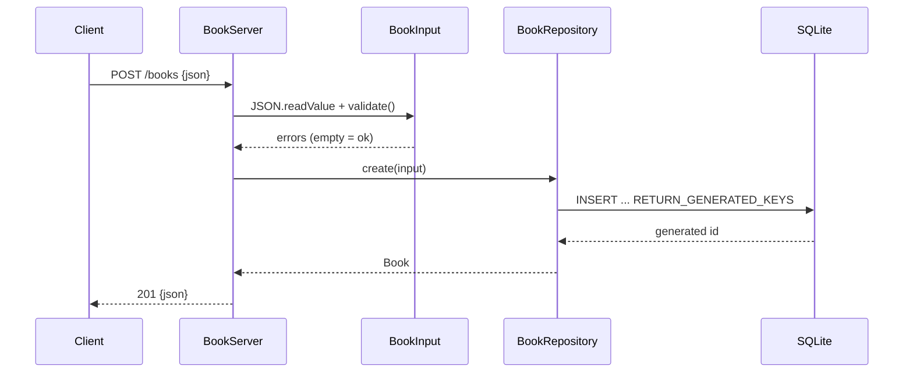

# Flow

A `POST /books` request is parsed by `BookServer.readBody`, which deserializes the body into a `BookInput` record and calls `validate()`; a malformed body or validation error short-circuits to a 400 JSON response. On success the input is passed to `BookRepository.create`, which inserts via a prepared statement and reads back the autoincremented id, returning a populated `Book` serialized as 201 JSON. Persistence is a single shared JDBC connection with all repository methods `synchronized`; errors propagate as a 500 "database error".
