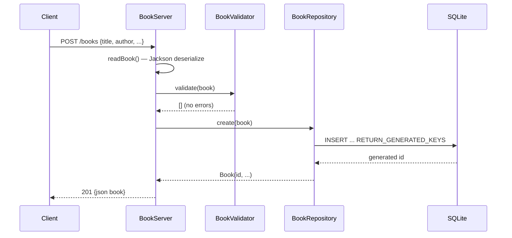

# Flow

A `POST /books` request is dispatched through `BookServer.route`, which parses the JSON body with Jackson (`FAIL_ON_UNKNOWN_PROPERTIES` disabled, so a client-supplied `id` is ignored). The parsed `Book` is validated by `BookValidator` — a blank title or author yields a 400 with an error-detail list before any DB access. On success, `BookRepository.create` inserts the row via a synchronized `PreparedStatement`, reads the auto-generated key, and the server serializes the persisted book back as 201 JSON. Error handling is present throughout: malformed JSON → 400, empty body → 400, unexpected runtime exceptions → 500, unknown route → 404, wrong method → 405 with an `Allow` header. Repository access is single-connection and fully synchronized.
