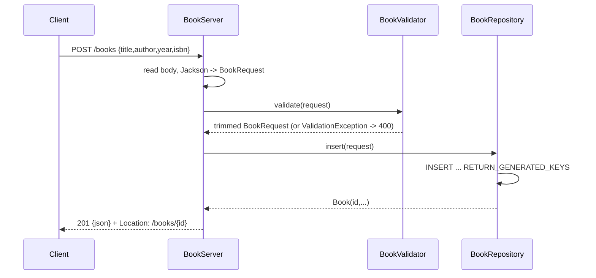

# Flow

A `POST /books` request reads the body, deserializes it with Jackson (unknown
properties ignored), and validates it via `BookValidator` — missing/blank title
or author, out-of-range year, or a bad ISBN check digit yield a `400` listing
every error. On success the repository performs a prepared `INSERT` on the shared
SQLite connection, reads the generated key, and the server returns `201` with the
created book and a `Location` header. Error handling is centralized in `handle()`,
which maps `ValidationFailure`/`BadRequest` → 400, `MethodNotAllowed` → 405,
`SQLException` → 500, and any other runtime exception → 500. Repository methods are
`synchronized` to serialize access to the single JDBC connection across the
server's 4-thread pool.
