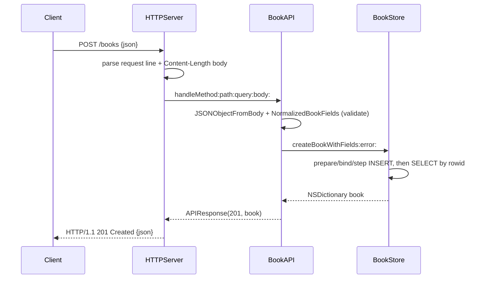

# Flow

A POST to `/books` is read off the socket by `HTTPServer` (headers until `\r\n\r\n`, then exactly `Content-Length` body bytes, with 16 KB/1 MB caps). The router `BookAPI` decodes the JSON object, validates it via `NormalizedBookFields` (title and author must be non-blank strings; year must be an integer 0–9999; booleans/floats and non-string isbn are rejected), inserts through `BookStore`'s prepared-statement helper, re-reads the inserted row, and returns `201` with the created book. Validation failures short-circuit to `422` (with a `details` array), malformed/non-object JSON to `400`. The server is single-connection, closing each connection after one response; SQLite is opened `SQLITE_OPEN_FULLMUTEX`. Input validation and DB-error handling are present throughout.
