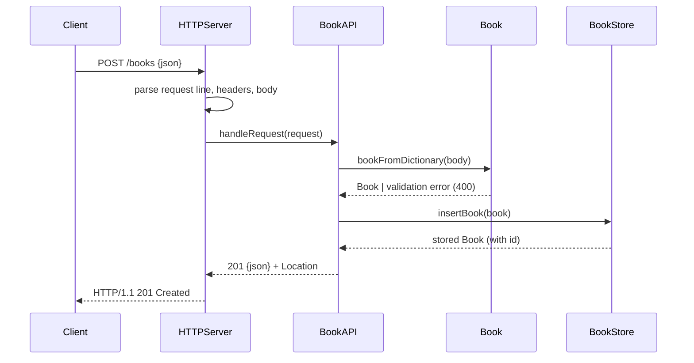

# Flow

A `POST /books` is read off the socket by `HTTPServer` (bounded header/body sizes, 5s recv timeout, `SIGPIPE` ignored), split into method/path/query/body, and dispatched to `BookAPI -handleRequest:`. The API parses the JSON body, validates it via `Book +bookFromDictionary:error:` (title and author required; 400 on failure), persists through `BookStore -insertBook:` (parameterized SQLite with transient-bound text), and returns `201` with the serialized book and a `Location` header. The server is single-threaded (`serveForever` handles one connection at a time) and always sends `Connection: close`.
