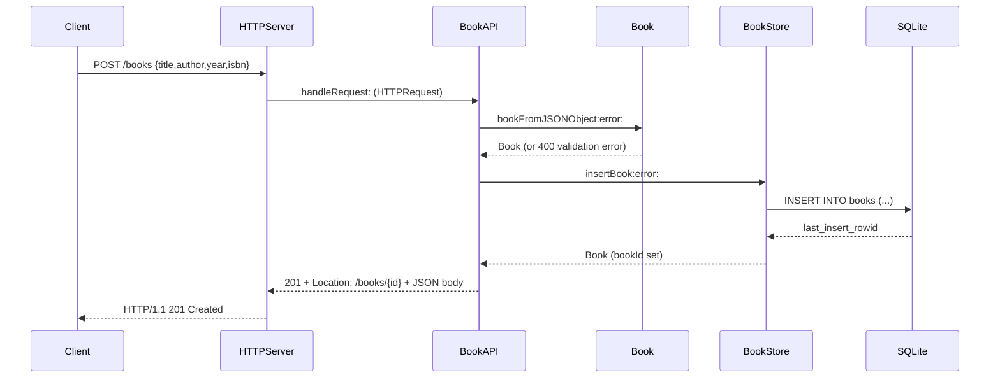

# Flow

A `POST /books` is parsed by `HTTPRequestCreate` into a path/query/body, routed by `BookAPI handleRequest:` which validates the JSON body through `Book bookFromJSONObject:error:` (title and author required and non-blank; year must be an integer 0–9999 if present; isbn optional). On success the book is persisted by `BookStore insertBook:` via a prepared SQLite statement, the generated row id is assigned, and a `201 Created` with a `Location` header and the JSON book is returned. Errors are mapped to HTTP status codes through a shared `BookErrorDomain` enum (validation→400, not-found→404, database→500). The routing layer is deliberately socket-independent, so tests drive `handleRequest:` directly as well as over a real loopback socket.
