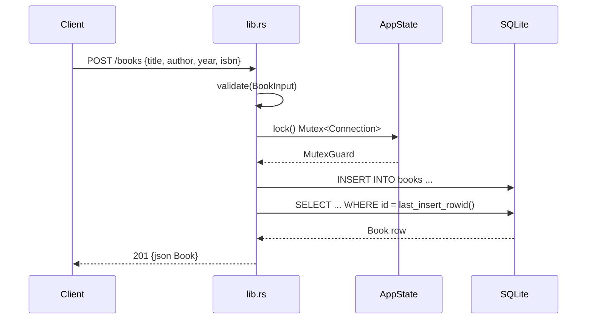

# Flow

A `POST /books` request is deserialized into `BookInput`; `validate()` trims and rejects a blank `title`/`author` (400), a negative `year`, and a non-numeric `isbn`. On success the handler locks the single `Arc<Mutex<Connection>>`, inserts the row, re-reads it by `last_insert_rowid()`, and returns `201` with the stored `Book`. Persistence is a single bundled-SQLite connection serialized through a mutex (not a pool); JSON (de)serialization uses serde. Malformed JSON bodies are mapped to `400` via a `JsonRejection` guard rather than the default 422/plain-text response.
