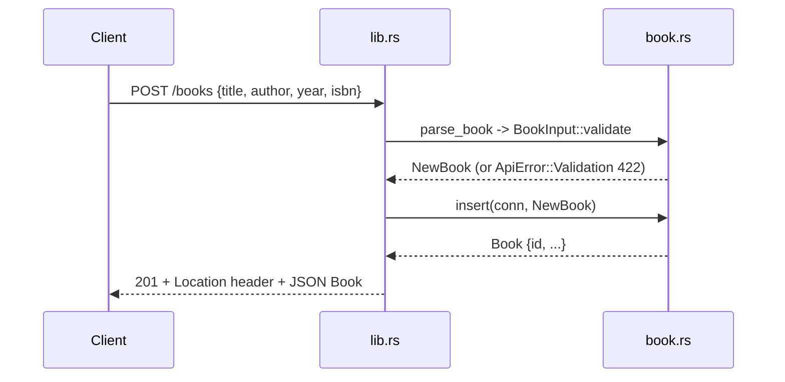

# Flow

A `POST /books` request is read as raw `Bytes`, deserialized into `BookInput` (all fields optional so validation can report every problem at once), and validated: `title`/`author` must be non-blank after trimming, `year` must be 0–9999, `isbn` must be a well-formed ISBN-10/13 (check digit not verified). On success the handler locks the shared `Arc<Mutex<Connection>>`, inserts the row, re-reads it to get the autoincrement id, and returns `201 Created` with a `Location` header and the JSON body. Validation failures map to `422 Unprocessable Entity` with a `details` array; malformed JSON maps to `400`; DB errors map to `500`. Persistence is real SQLite (`rusqlite` bundled), not in-memory state. Concurrency is serialized through a single mutex-guarded connection.
