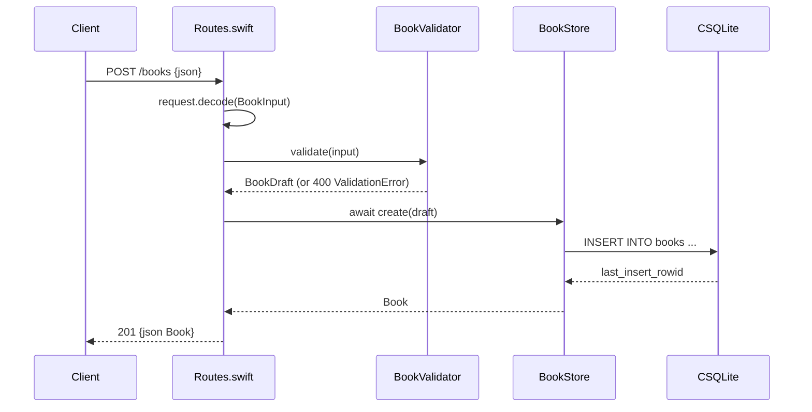

# Flow

A `POST /books` decodes the JSON body into `BookInput` (malformed JSON → 400), validates it via `BookValidator` (missing title/author, out-of-range year, or malformed ISBN → 400 with a `details` list of every problem), then persists it through the `BookStore` actor, which binds a prepared `INSERT` against SQLite via the `CSQLite` system-library shim and returns the row with its generated id. All DB access is serialized through the actor. Validation is thorough (trimming, year range 1000..next-year, ISBN-10/13 shape check) and exceeds the spec's "title and author required" minimum.
