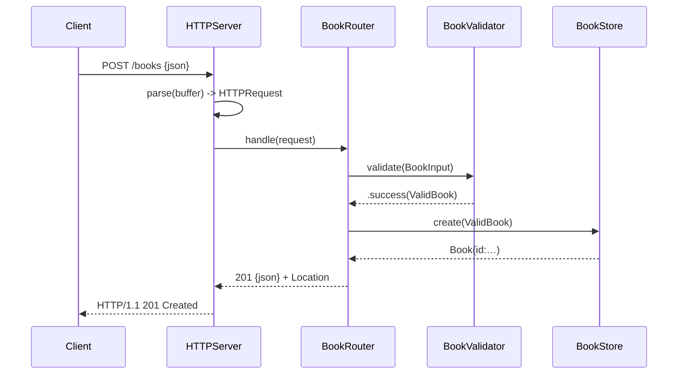

# Flow

A request is read off the connection and parsed by `HTTPServer.parse` (which
reports `incomplete`/`tooLarge`/`malformed` so partial reads are handled). The
socket-independent `BookRouter.handle` dispatches on `(segment count, first
segment)`, validates/normalizes the body through `BookValidator`, and calls the
lock-serialized `BookStore` over `libsqlite3`. Responses are JSON with precise
status codes. Validation deviates toward being thorough (trimming, blank
rejection, plausible-year range); PUT performs a full replace rather than a
partial merge. The server handles one request per connection and closes it.
