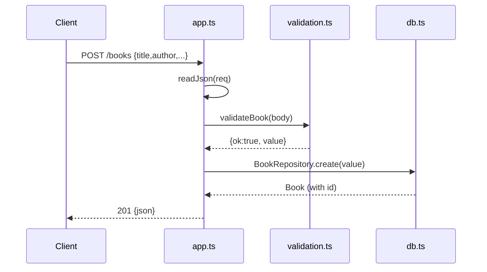

# Flow

A `POST /books` request is buffered by `readJson` (with a 1 MiB cap and strict JSON parsing), validated by `validateBook` (title/author required, year/isbn optional and type-checked), then inserted via a prepared statement in `BookRepository.create`, which re-reads the row to return the persisted record with its generated id. Errors are funneled through a single `HttpError` class and a top-level `.catch` that maps known errors to their status and anything else to `500`. Routing is a hand-rolled method/path switch over `node:http` with no framework; persistence is synchronous `node:sqlite`.
