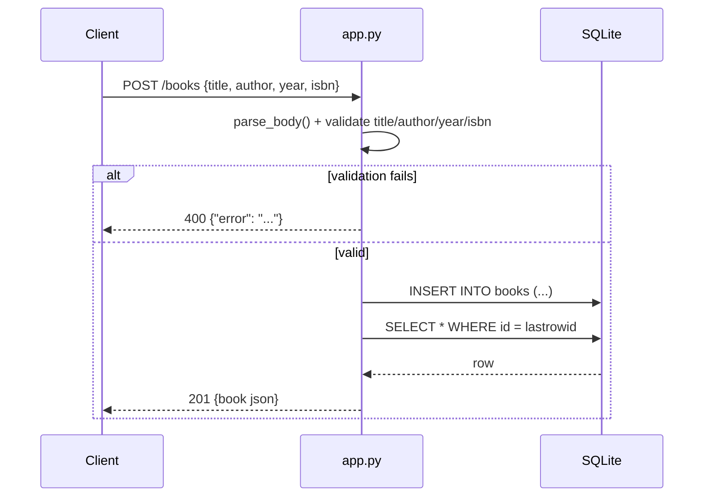

# Flow

A `POST /books` request is parsed as JSON (`parse_body`), then each field is
validated: `title`/`author` must be non-empty strings, `year` must be an int (or
absent), `isbn` a non-empty string (or absent). On any failure the handler returns
400 with a semicolon-joined error message. On success it inserts via a parameterized
query, re-selects the row by `lastrowid`, and returns it as JSON with 201. The DB
connection is per-request (`get_db` stores it on Flask's `g`, torn down in
`close_db`), and the schema is created once at app construction via `init_db()`.
