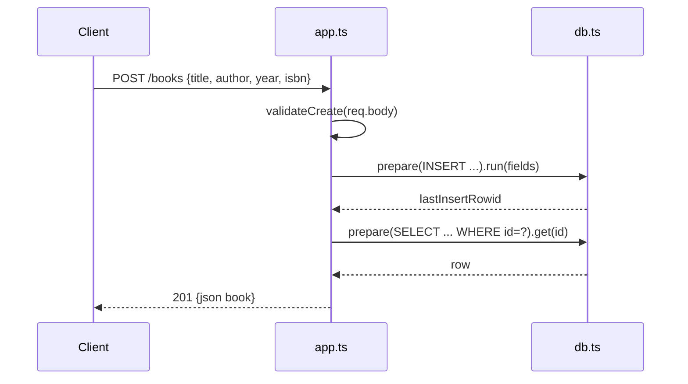

# Flow

A request to `POST /books` is parsed by `express.json()`, then `validateCreate()` enforces that `title` and `author` are non-empty strings and that `year`/`isbn` have correct types when present (throwing `ValidationError` → 400 otherwise). The validated fields are inserted via a prepared `better-sqlite3` statement, the stored row is read back by `lastInsertRowid`, and it is returned as JSON with 201. Validation errors, malformed JSON (`entity.parse.failed`), and unexpected errors are centralized in a single Express error-handling middleware that returns structured JSON with 400/500 codes. Persistence is synchronous (better-sqlite3), which is idiomatic for that library.
