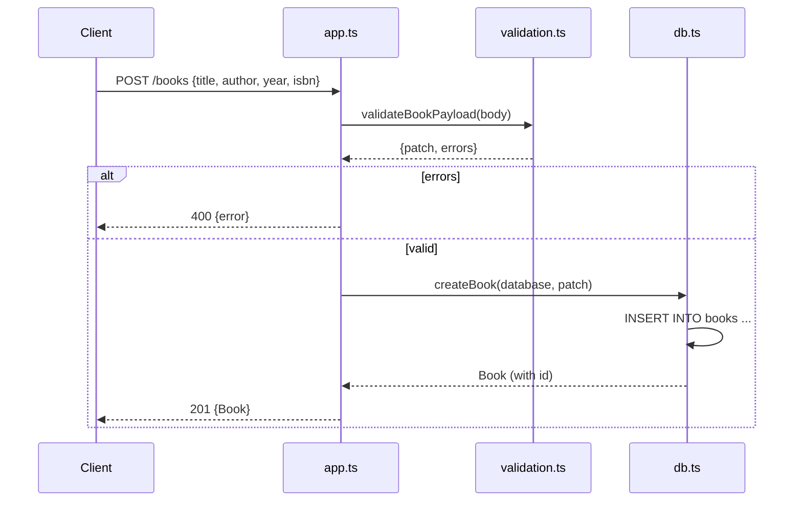

# Flow

A `POST /books` request is parsed by `express.json()`, then `validateBookPayload` checks that `title`/`author` are non-empty strings and that optional `year` (integer 1000–2100) and `isbn` (ISBN-10/13 after stripping hyphens/spaces) are well-formed. On any validation error the handler returns `400` with a joined error message. On success `db.ts:createBook` performs a parameterized `INSERT` and re-reads the row, and the handler returns `201` with the persisted book. Persistence is real SQLite (`node:sqlite`), with dependency injection of the DB handle so tests run against `:memory:`. Input validation, 404 handling, malformed-JSON handling, and a case-insensitive author filter are all present.
