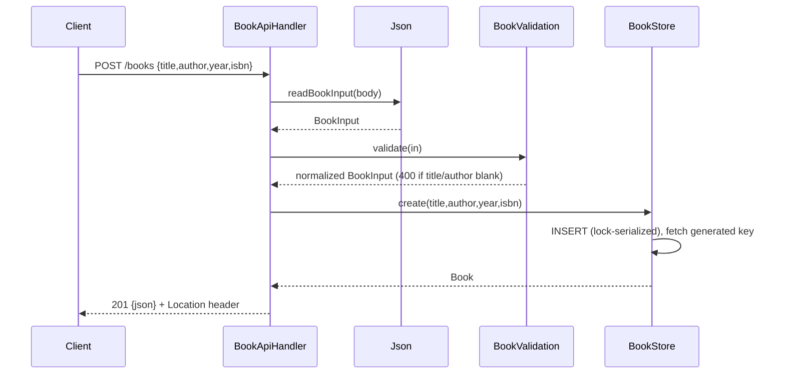

# Flow

A `POST /books` request has its body parsed by Jackson into a `BookInput`, validated (title and author required and trimmed; blank → 400), then inserted into the SQLite `books` table under a `ReentrantLock` that serializes all repository access. The generated row id is returned as a `Book` and rendered as `201` JSON with a `Location: /books/{id}` header. All handler work runs inside a single try/catch that maps `BookException` to its carried status and any other throwable to `500`. DB access is synchronous and single-connection; the lock makes it safe for the fixed 8-thread server pool.
