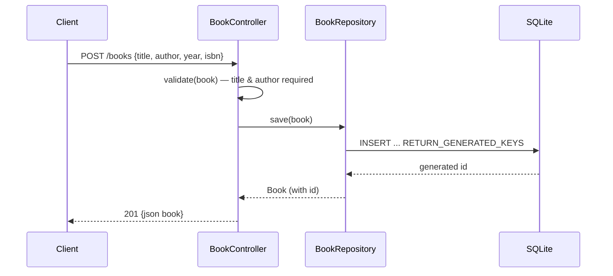

# Flow

A `POST /books` request is validated in the controller (`title` and `author`
must be non-blank, else a `ResponseStatusException(400)` is raised and converted
to `{"error": ...}` by `GlobalExceptionHandler`). On success the repository
inserts via `JdbcTemplate` with `GeneratedKeyHolder` to recover the
auto-increment id, sets it on the POJO, and the controller returns `201` with
the full book. Persistence is a real SQLite file (`books.db`), schema created
from `schema.sql` on startup. Validation is duplicated on `PUT`, and 404s are
raised consistently for missing ids on get/update/delete.
