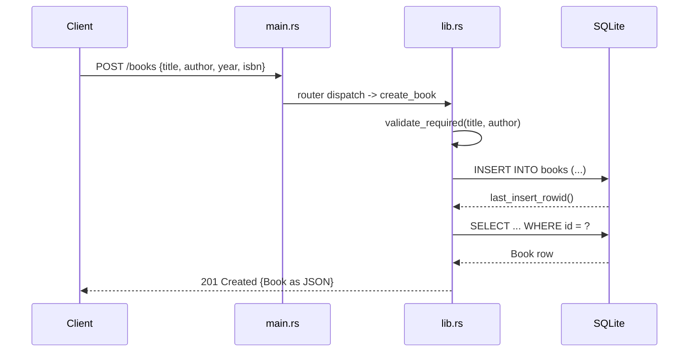

# Flow

A `POST /books` request is routed by `router()` to `create_book`, which first trims and validates that `title` and `author` are non-empty (returning `400 {error}` via `ApiError::BadRequest` otherwise). It then locks the shared `Arc<Mutex<Connection>>`, inserts the row, re-reads it by `last_insert_rowid()`, and returns `201` with the created `Book` serialized to JSON. The DB connection is a single mutex-guarded rusqlite `Connection` (synchronous SQLite access inside async handlers); errors map through the `ApiError` enum to appropriate status codes (400/404/500). Optional `year`/`isbn` are skipped from serialization when absent.
