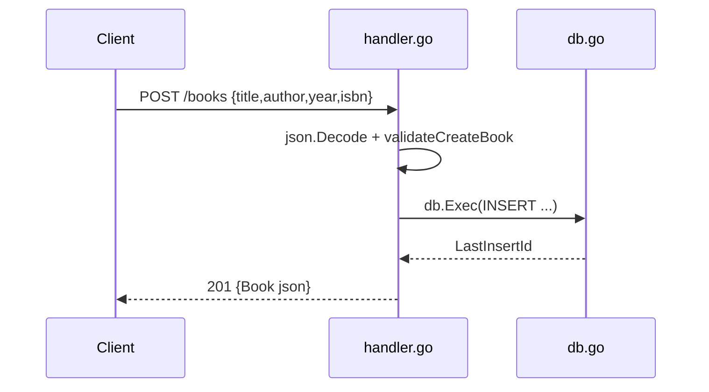

# Flow

A `POST /books` request is dispatched by `booksHandler` to `createBook`, which
decodes the JSON body into `CreateBookRequest`, rejects it with `400` when
`title` or `author` is blank, inserts a row via a parameterized SQL statement,
maps a `UNIQUE constraint failed` error to `409`, and returns the created book
with `201`. Persistence is synchronous SQLite through the pure-Go
`modernc.org/sqlite` driver; a single package-level `*sql.DB` is shared across
handlers. Notable deviations: `PUT /books/{id}` never updates or re-reads the
`isbn` column, so its response reports `isbn:""` when the client omits it;
`extractID` never returns an error, so a non-numeric id yields `404` rather than
`400`.
