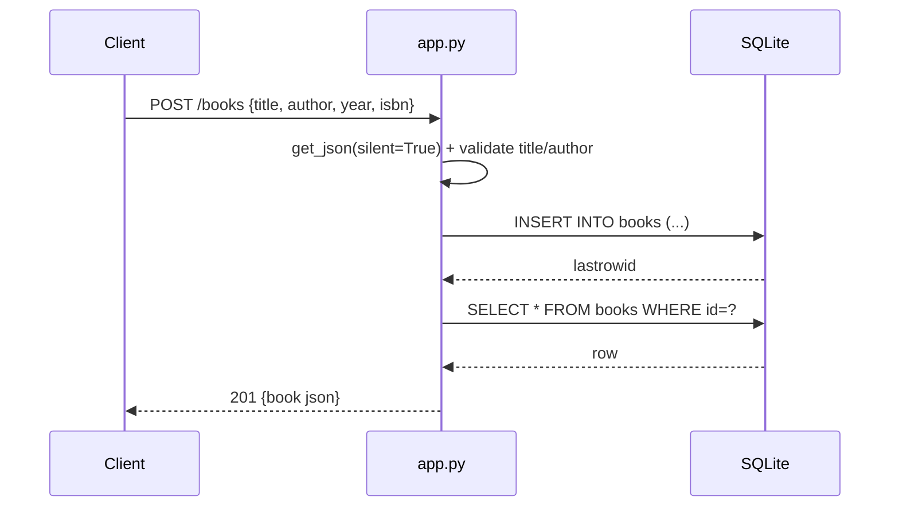

# Flow

A request to `POST /books` parses the JSON body with `request.get_json(silent=True)`, rejects a missing/empty title or author with 400, coerces `year` to int (400 on failure), inserts the row into the SQLite `books` table via a per-request connection (`get_db()` stored on Flask's `g`, closed on teardown), re-selects the inserted row, and returns it as JSON with status 201. Validation covers required fields and year type; there is no uniqueness check on isbn. The DB connection is opened lazily per request context and closed in `teardown_appcontext`.
