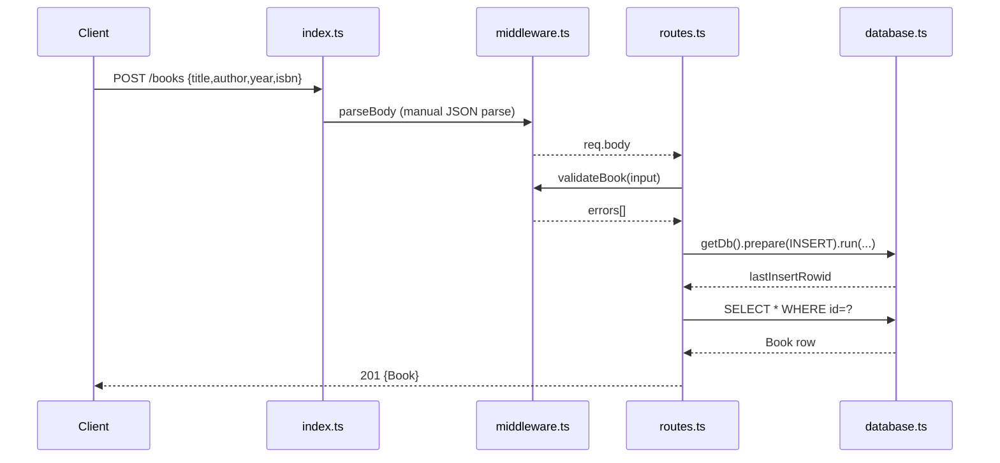

# Flow

A `POST /books` request is body-parsed by the custom `parseBody` middleware (which hand-parses JSON off the raw request stream rather than using `express.json()`), validated by `validateBook`, inserted via a prepared `better-sqlite3` statement, re-read by id, and returned as `201`. A `SQLITE_CONSTRAINT_UNIQUE` on the isbn column is caught and mapped to `409`. Not-found and validation errors are thrown as plain tagged objects (`{type:'not_found'}`) and converted to `404`/`400` by the `handleError` error middleware. Validation requires all four fields (title, author, year, isbn) on create, which is stricter than the spec (which only mandates title and author).
