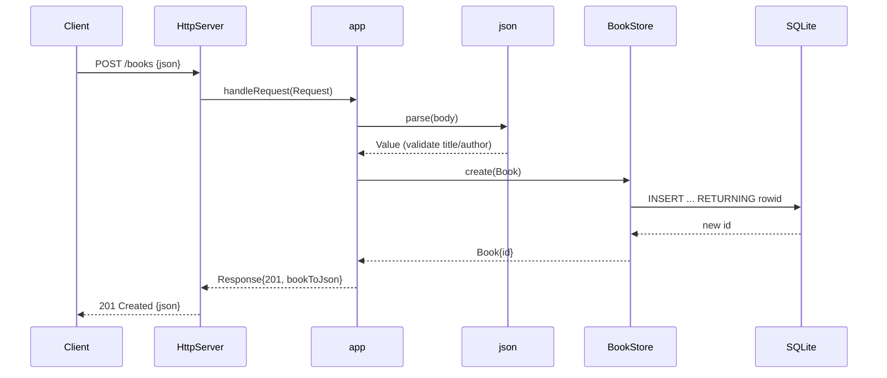

# Flow

A request to `POST /books` is read by the socket server (`server.cpp`), parsed
into a `Request`, and dispatched through `app.cpp:handleRequest`. The body is
parsed by the embedded `json` module and validated: `title` and `author` must be
non-blank strings (else `400`); `year`/`isbn` are optional with type checks.
On success the book is inserted via `BookStore::create` (SQLite,
mutex-guarded), the generated id is read back with `last_insert_rowid`, and the
book is serialized to JSON with a `201`. Routing handles trailing-slash
normalization, numeric-id parsing (rejecting non-positive/non-numeric → 404),
`405` for wrong methods, and a top-level try/catch returning `500` on any
exception. Persistence is real SQLite (not in-memory state); the end-to-end
test exercises the full TCP path.
