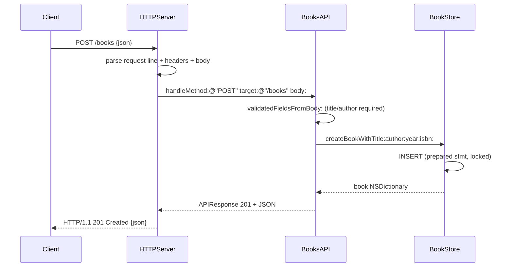

# Flow

A request arrives on a BSD socket; `HTTPServer` reads the header block (bounded at 64 KiB), parses the request line and `Content-Length`, reads the body (bounded at 1 MiB), and passes method/target/body to `BooksAPI` — the transport layer knows nothing about books. `BooksAPI` parses the path and query string, validates the JSON payload (missing/blank title or author → 422; malformed JSON or non-object → 400), delegates to `BookStore`, and returns an `APIResponse`. `BookStore` runs a parameterised SQL statement under an `NSLock` and returns the row as a dictionary. The server serialises the response with the correct status and reason phrase. Notable: validation is richer than the spec's "400" (semantic errors use 422), SQL is always parameterised (filter injection is tested), each connection is `Connection: close` (one request per connection), and concurrency is handled via a concurrent GCD worker queue with a serialised accept loop.
