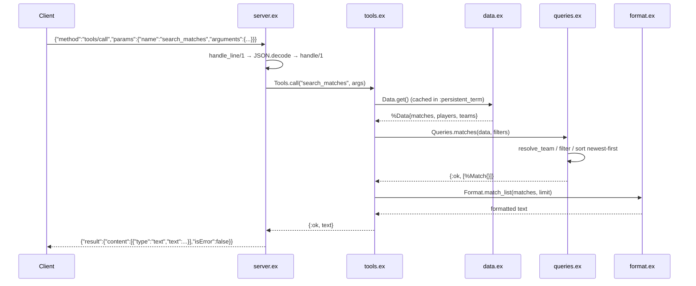

# Flow

A `tools/call` request arrives as one newline-delimited JSON line.
`server.ex:handle_line/1` decodes it and routes to the pure `handle/1`, which for
`tools/call` validates the tool name/arguments and delegates to
`Tools.call/3`. Tools lazily obtain the knowledge base via `Data.get/0` (loaded
once from the six CSVs and cached in `:persistent_term`), run the relevant
`Queries` function — here `Queries.matches/2`, which resolves the team name to a
canonical key, applies the filters, and sorts newest-first — then render the
result through `Format`. The text is wrapped in an MCP `content` result.
Tool exceptions are caught and returned as `{:error, message}` → an `isError:
true` result rather than a transport crash. Unknown tools map to JSON-RPC error
`-32602`; unknown methods to `-32601`; parse failures to `-32700`.
