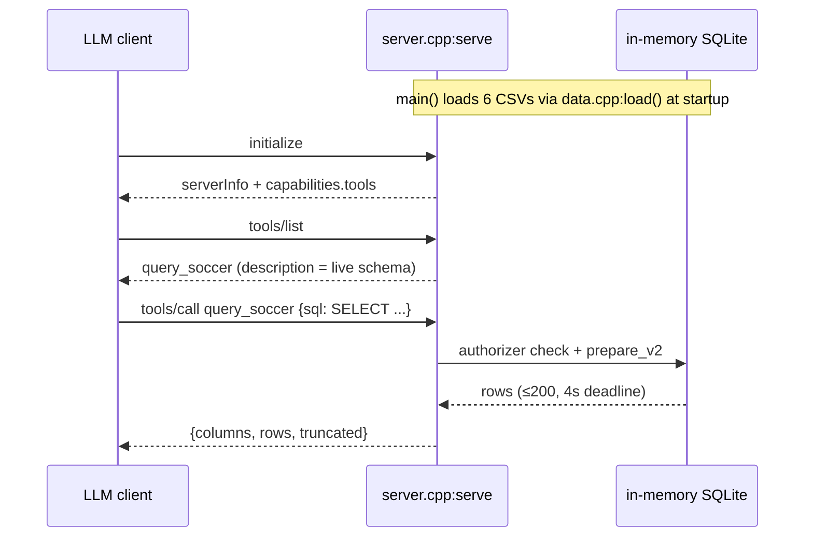

# Flow

A user question is translated by the LLM into one read-only SQL `SELECT` and sent as a `tools/call`. `server.cpp:query` (48) prepares the statement, rejects anything that isn't a single SELECT or that trips the authorizer (writes, disallowed functions), steps up to 200 rows under a 4-second deadline, and returns `{columns, rows, truncated}` as MCP text content. All five required capability categories (match / team / player / competition / statistical) are served by this one generic SQL endpoint over the pre-built `matches`, `performances`, `standings`, `derbies`, and `players` relations rather than by dedicated per-category tools.

Notable: single-tool "SQL passthrough" design instead of semantic MCP tools; data correctness depends on startup reconciliation heuristics (score backfill from the extended file within ±1 day; hard-coded cup-final round numbers for a few seasons) that the README discloses as approximate. No network calls; FIFA player data is a static snapshot with no per-match scorer events.
