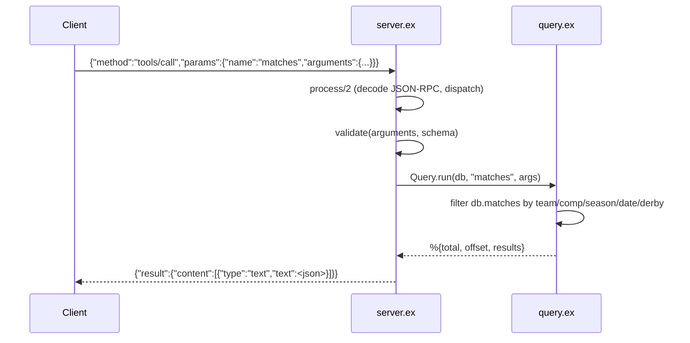

# Flow

On startup `Server.main/1` calls `Data.load/1`, which reads the five match CSVs and the FIFA CSV once, normalizes team names, and de-duplicates the same fixture across sources (matching by `{competition, home, away}` and date proximity within ±1 day, preferring distinct rounds). The server then reads newline-delimited JSON-RPC messages from stdin. For a `tools/call`, it looks up the tool in `@definitions`, validates arguments against the declared schema (type/enum/date/range checks plus cross-field rules like `opponent` requiring `team`), runs the query against the preloaded in-memory `db`, and returns the result JSON-encoded in MCP `content` form. Matches/statistics/standings all share one generic filter pass over `db.matches`; `statistics` and `standings` only count fixtures with integer scores, so unplayed/scheduled rows are excluded rather than counted as draws. Error handling is explicit: parse errors, unknown methods, unknown tools, and invalid arguments each map to distinct JSON-RPC error codes or `isError` tool results.
