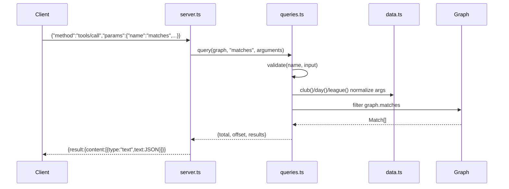

# Flow

On startup the server builds a `Graph` once by reading all six CSVs from `data/kaggle/`, normalizing team names (`club()`), parsing dates (`day()`), and merging duplicate fixtures across overlapping Serie A sources. Each `tools/call` runs synchronously: `validate()` type-checks args against the tool's JSON schema (rejecting bad dates/ranges and `opponent` without `team`), the matching branch of `query()` filters the in-memory arrays and paginates, and the server wraps the JSON result in MCP text content. Errors thrown by `query()` are caught and returned as `isError` tool results rather than JSON-RPC errors. No async I/O, no external APIs, no persistence beyond the in-memory graph.
