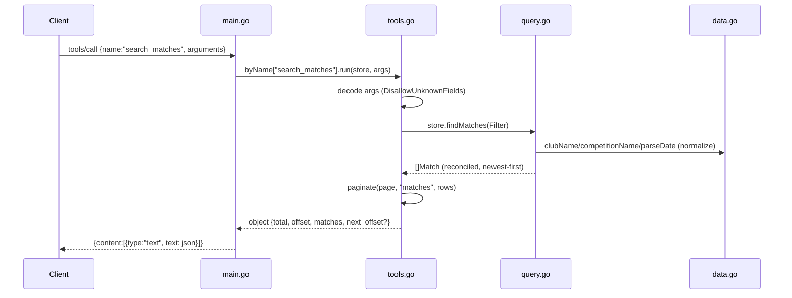

# Flow

At startup `main.go:main` calls `data.go:loadStore`, which reads the five match CSVs plus the FIFA players CSV, normalizes team/competition names and dates, then `fixtures.go:reconcileMatches` deduplicates fixtures that appear across sources (merging scores, stadium, states, stats and tagging cup/Libertadores finals) into a single `matches[]` while keeping each source independently queryable via `bySource`.

A `tools/call` for `search_matches` decodes arguments strictly (`DisallowUnknownFields`), validates filter invariants (side requires team, ordered season/date ranges), filters the reconciled matches, and returns a paginated page. Notable traits: zero external dependencies (stdlib only), nullable goals model unscored fixtures, accent/alias-insensitive name matching, and strict JSON-RPC error codes (-32700/-32600/-32601/-32602/-32603). Notifications (no id) are correctly dropped without a response.
