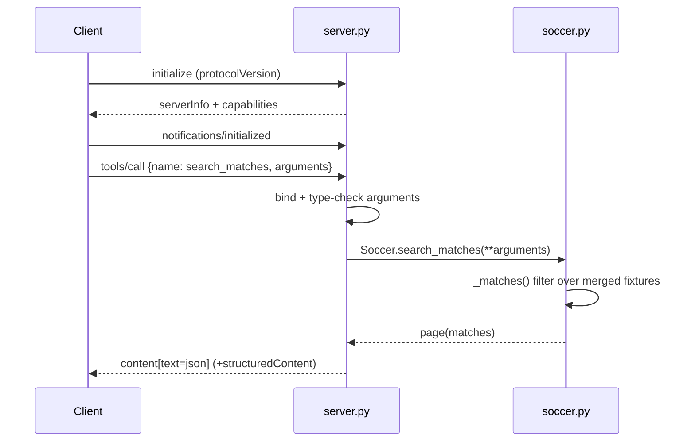

# Flow

On startup `main()` constructs `Soccer()`, which eagerly reads all six CSVs, normalizes
team names (alias table + accent/state-suffix handling), merges overlapping fixtures across
sources within a 1-day window, and sorts matches and players once. A `tools/call` for
`search_matches` is validated against the method signature (argument binding + per-argument
type check in `server.py:call_tool`), dispatched to `Soccer.search_matches`, filtered in
`_matches`, and returned as paginated JSON. Errors are surfaced as JSON-RPC errors (protocol
faults) or `isError` tool results (bad arguments) rather than crashing the loop. Notable:
all data is loaded in-memory at startup (no DB, no external API calls); the merge logic that
reconciles the five match CSVs is the most intricate part of the system.
