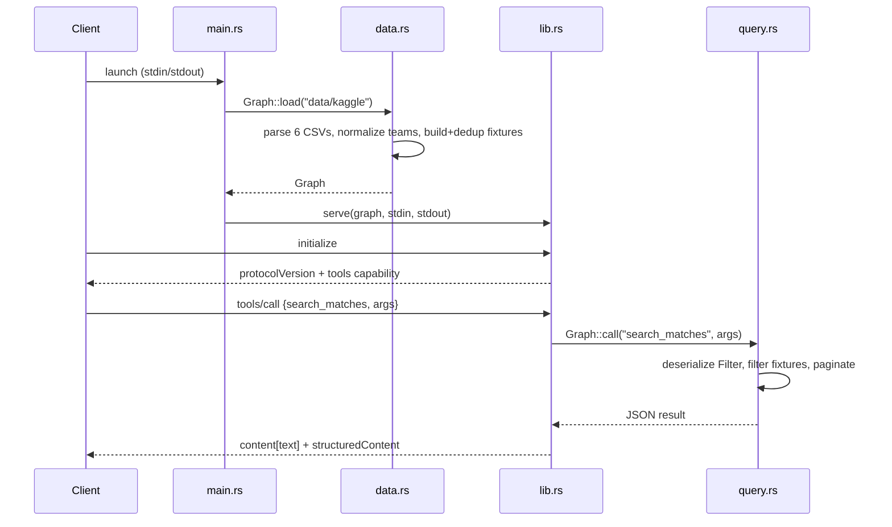

# Flow

At startup `Graph::load` reads all six CSVs once, normalizing team names (accent folding + an alias table resolving suffixes like `-SP` and full club names), parsing both ISO and `DD/MM/YYYY` dates, and merging duplicate match records across feeds into a deduplicated `fixtures` list while retaining raw rows for per-source queries. The server then reads newline-delimited JSON-RPC from stdin; after `initialize` negotiates a protocol version, each `tools/call` deserializes a strongly-typed argument struct (`deny_unknown_fields`), filters the in-memory data, and returns both a text rendering and `structuredContent`. Notable: fully in-memory (no external APIs, no async), strict argument validation rejects unknown fields, pagination via `limit`/`offset`/`next_offset`, and standings/relegation are computed from scores (with a double-round-robin completeness guard) rather than hardcoded.
